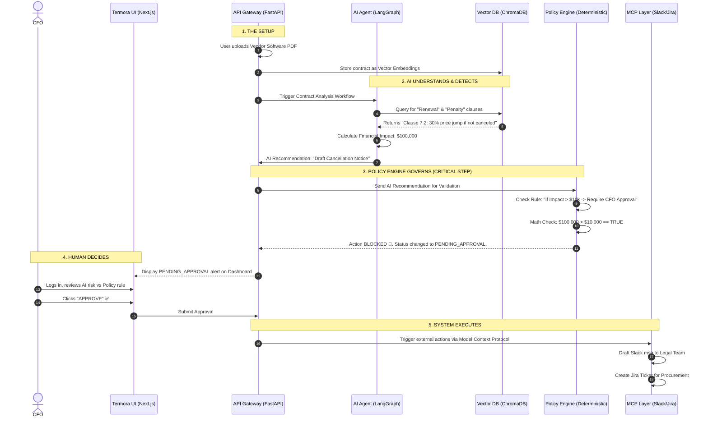

# The $100,000 Software Renewal Story - Workflow Diagram

Here is the visual representation of how the Termora architecture handles the "$100,000 Software Renewal" scenario.

### Key Takeaways from the Diagram:
* **Steps 2 to 3:** Notice how the AI does NOT talk directly to the execution layer (MCP). It *must* pass through the Policy Engine. This is the core of your deterministic governance.
* **Step 4:** The human (CFO) is kept in the loop specifically because the mathematical rule in Step 3 required it.
